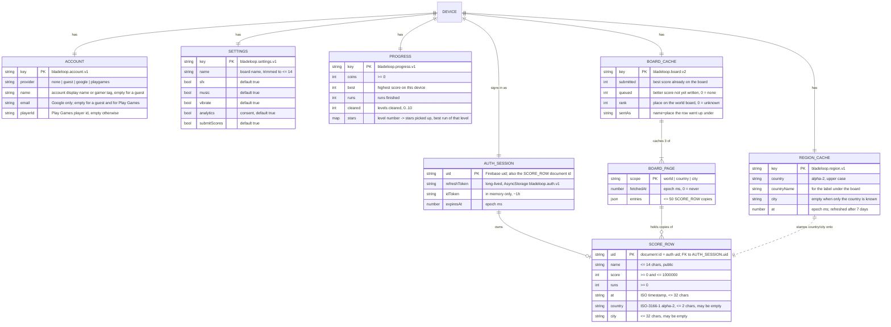
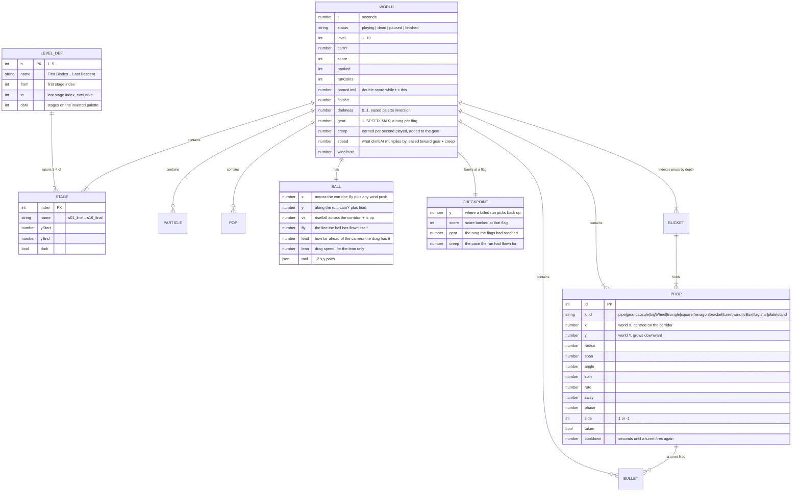

# ER — Entity-Relationship Model

**Project:** BladeLoop
**Last updated:** 2026-09-17

BladeLoop has no relational database. Its data lives in three places, and this
document covers all three:

1. **Firestore** — one public collection, `scores`, one document per device.
2. **AsyncStorage on the device** — six singleton records, each a whole JSON
   blob under one key (`src/state/store.ts`).
3. **The in-memory world** — the simulation's own entities, rebuilt from the
   level script on every run and never persisted.

The Mermaid sources below render natively on GitHub, and can be pasted into
<https://mermaid.live> for an image.

---

## 1. Persisted model

### Keys and ownership

| Entity | Primary key | Foreign key | Cardinality |
| --- | --- | --- | --- |
| `SCORE_ROW` (`scores/{uid}`) | document id = Firebase `uid` | — | 1 per device, 0 until a first score is written |
| `AUTH_SESSION` | `uid` | → `scores/{uid}` | exactly 1 per install |
| `ACCOUNT` / `SETTINGS` / `PROGRESS` / `REGION_CACHE` / `BOARD_CACHE` | AsyncStorage key | — | exactly 1 per install (singleton) |
| `BOARD_PAGE` | `scope` | — | exactly 3 per `BOARD_CACHE` |

The device's `uid` is the only join in the system. Everything else is a
singleton blob that is read whole and written whole.

### Constraints

Enforced by [`firestore.rules`](../firestore.rules) on every write:

- The writer must be authenticated **and** `request.auth.uid == uid` — a
  device may only write its own row.
- `keys().hasOnly(['name','score','runs','at','country','city'])` — no extra
  fields may be bolted onto a document every player downloads.
- `name` string ≤ 14, `country` string ≤ 2, `city` string ≤ 32, `at` string
  ≤ 32, `score` int in `[0, 1000000]`, `runs` int ≥ 0.
- `read: true` — the board, including every name, country and city, is public.
- `delete: false`, and every other path in the project is closed.

Enforced by the client:

- `setName()` trims and cuts to `MAX_NAME` (14) before anything stores it.
- `cleanName()` in `src/services/Leaderboard.ts` drops control characters
  before a name reaches the board.
- `spendCoins()` refuses to go below zero; `addCoins()` floors at zero.
- `recordClear()` only ever moves `cleared` forward, capped at `LEVEL_COUNT`,
  and a level's entry in `stars` only ever goes up: a replay can win the stars
  that were missed and cannot lose the ones already won.
- `stars` goes through JSON, so it comes back off disk with string keys and is
  typed `Record<string, number>` and indexed with the level number. A save
  written before this field existed simply has no entry for any level, which
  reads as zero stars picked up — nothing needs migrating.
- A write happens only when a run beats `submitted`, or when the name or place
  on the row changed — so a long session costs one write.

### Indexes

[`firestore.indexes.json`](../firestore.indexes.json) — the world board needs
none (one order, one field); the other two filter before they order:

| Index | Fields |
| --- | --- |
| Country board | `country ASC`, `score DESC` |
| City board | `country ASC`, `city ASC`, `score DESC` |

Without them the country and city tabs come back empty — Firestore answers
`FAILED_PRECONDITION`, which the service treats as any other failed read.

### Data lifecycle

| Record | Created | Updated | Destroyed |
| --- | --- | --- | --- |
| `AUTH_SESSION` | First time the board is touched (anonymous sign-up) | On token refresh, or on Google sign-in | Uninstall; `signOut()` clears the key |
| `SCORE_ROW` | First score that beats 0 with `submitScores` on | On a new best, or a changed name/place | Never (delete is denied) |
| `PROGRESS` | First run | Every run, clear and purchase | "Reset progress" in settings |
| `SETTINGS` | First launch (defaults) | Settings screen, mute button | Uninstall only — a reset leaves it alone |
| `ACCOUNT` | Login screen | Sign-in / sign-out | Uninstall |
| `REGION_CACHE` | First lookup | After 7 days | Uninstall |
| `BOARD_CACHE` | First board fetch | Each fetch or write | Uninstall |

---

## 2. Runtime model (in memory, never persisted)

### Runtime constraints

- World Y grows with progress and draws left to right; world X is centred on
  the corridor, runs `-HALF_W … +HALF_W` (±165 px) and draws up and down. The
  drawing turns the whole layer a quarter to get there; the simulation never
  sees it.
- The ball flies between the corridor's own two walls, `FLOOR_X` to `CEIL_X`
  (±154 px). Reaching either is not a death.
- The drag carries the ball at most `DRAG_BAND` (120 px) along the run from
  the camera line.
- The simulation steps at `FIXED_DT` (1/60 s) and catches up at most
  `MAX_STEPS` (5) steps per frame, so returning from the background never
  fast-forwards a run.
- `props` are bucketed by depth (`buckets`, `near`, `nearKey`) so collision,
  pickups, wind and drawing sweep only the buckets around the ball — the last
  stage holds several hundred props.
- A respawn backs up `RESPAWN_BACKUP` (220 px) and picks a lane that stays
  clear for `RESPAWN_CLEAR` (2.1 s); nothing is immune, so the picker is
  best-effort rather than a guarantee.

### Scoring and economy

| Event | Effect |
| --- | --- |
| Passing a flag | `+FLAG_SCORE` (150) and `+FLAG_COINS` (2), banks `CHECKPOINT` with the gear *and creep* it was passed with, and raises the descent by `SPEED_STEP` (0.12 of the opening pace) to a ceiling of `SPEED_MAX` (1.36) |
| A second of the run | `+CREEP_RATE` (`SPEED_STEP / 90`) of creep, added to the gear and held at the same `SPEED_MAX`: the level quickens as it is flown |
| Taking a TV box | Bursts coins, doubles score for `BONUS_SECS` (10 s) |
| Taking a star | `+1` coin to `runCoins` |
| Finishing a run | `recordRun(score, coins)` → best, coins, runs |
| Clearing a level | `recordClear(level, stars)` → opens the next level once; banks the run's stars if it beat the level's best |
| Reviving | `-REVIVE_COST` (5) coins |

---

## 3. Where the model is defined in code

| Part | File |
| --- | --- |
| Runtime entities | [`src/game/types.ts`](../src/game/types.ts) |
| Tuning constants | [`src/game/config.ts`](../src/game/config.ts) |
| Level and stage definitions | [`src/game/level.ts`](../src/game/level.ts) |
| Persisted store primitive | [`src/state/store.ts`](../src/state/store.ts) |
| Progress / settings / account | [`src/state/`](../src/state/) |
| Score row, boards, cache | [`src/services/Leaderboard.ts`](../src/services/Leaderboard.ts) |
| Auth session | [`src/services/firebase.ts`](../src/services/firebase.ts) |
| Region cache | [`src/services/Region.ts`](../src/services/Region.ts) |
| Window shape and safe area, for the pages | [`src/ui/layout.ts`](../src/ui/layout.ts) |
| Which way up the phone is held | [`src/services/Orientation.ts`](../src/services/Orientation.ts) |
| Firestore constraints | [`firestore.rules`](../firestore.rules) |
