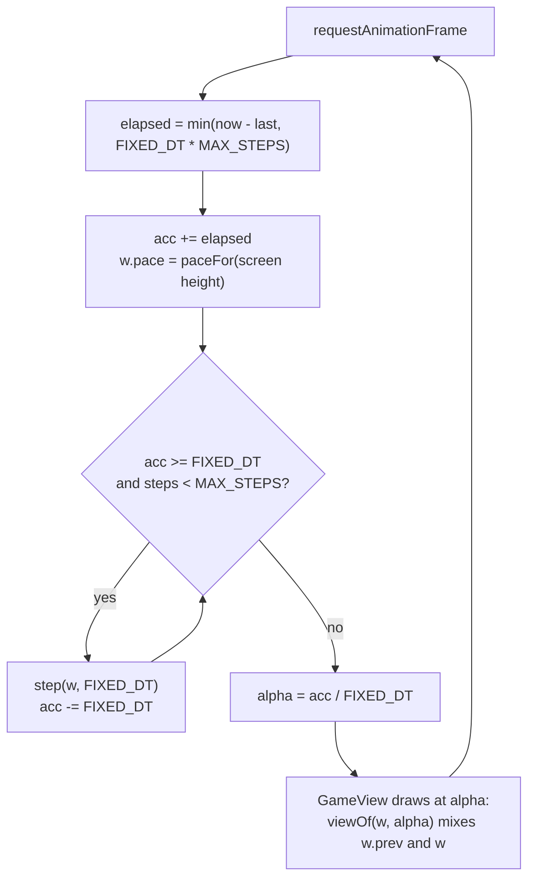
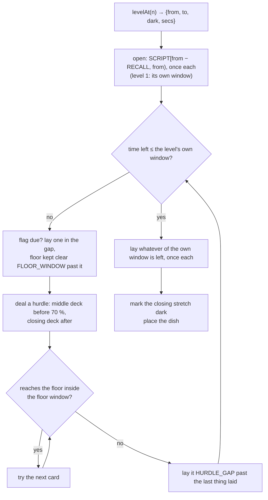
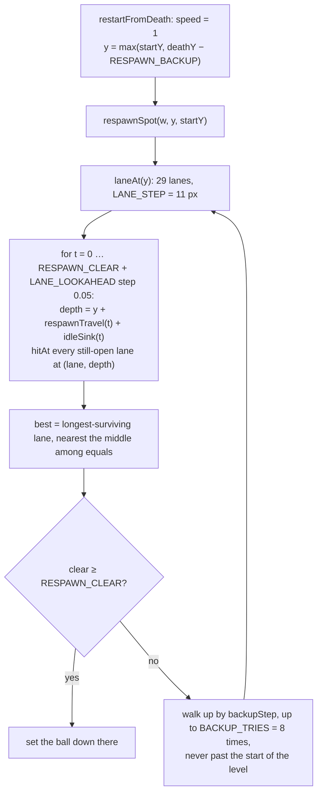

# BladeLoop — Game Algorithm & Physics

> **Purpose:** the whole of how a run works, in one place: the loop, the
> physics, the level builder, collision, death and respawn, scoring, and how
> all of it survives the phone being turned sideways.
>
> This describes the simulation as it stands in `src/game/`. Where a number is
> quoted it is the value in [`src/game/config.ts`](../src/game/config.ts) at
> the time of writing — that file is the source of truth, this document is the
> explanation.

**Status:** Active
**Last updated:** 2026-09-23
**Code:** [`src/game/config.ts`](../src/game/config.ts) ·
[`engine.ts`](../src/game/engine.ts) · [`level.ts`](../src/game/level.ts) ·
[`types.ts`](../src/game/types.ts) · [`src/ui/GameScreen.tsx`](../src/ui/GameScreen.tsx)
(loop + input) · [`src/ui/GameView.tsx`](../src/ui/GameView.tsx) (drawing)

---

## 1. The game in one paragraph

A ball flies down a corridor that scrolls past it, left to right, at a fixed
rate — that scroll is the level's clock, not something the player controls.
The corridor's two walls are the ceiling and the floor: gravity pulls the ball
toward the floor, a tap throws it back up, and dragging a finger nudges it
forward or back along the run by exactly the distance the finger travelled.
Blades, frames, wheels and launcher shots fill the corridor, and touching any of
them ends the run. The pace starts slow, runs a third quicker through the
middle of a level and eases back for the finish. Flags are checkpoints that pay
out; stars and consoles pay coins; a dish at the end ends the level.

There are exactly **two verbs**: tap to rise, drag to nudge. Everything below
serves those two.

**One thing to hold on to before reading any further:** the world's axes are
not the screen's. The corridor keeps the axes its sixty stages are authored in
— `x` across the corridor, `y` along the run — and the *drawing* turns that
whole layer a quarter so the run reads left to right (§11). So "`x`" below
means up and down the screen, and "`y`" means across it.

---

## 2. Coordinate system and units

| | |
| --- | --- |
| **X** | World px **across the corridor**, centred on it: `-HALF_W` (165) to `+HALF_W`. Drawn up and down the screen, `+X` at the top. This is the axis gravity and the taps work on. |
| **Y** | World px **along the run**, increasing with progress. Drawn left to right across the screen. This is the axis the scroll and the drag work on. |
| **Units** | Everything in the simulation is px and seconds. Speeds are px/s, gravity px/s². |
| **Origin** | Y = 0 is the start of stage 0. The ball starts before it, at `OPENING_Y = -470`. |
| **Screen** | The world is drawn into a box in its own axes, scaled, and the box is turned a quarter onto the screen — see §11. The simulation never sees screen px and never sees the turn. |

The corridor is `2 × HALF_W = 330` px across. The ball has radius `BALL_R = 11`,
so its centre lives in `[FLOOR_X, CEIL_X] = [-154, +154]` — **308 px of room to
fly**, about fifteen ball-widths, floor to ceiling.

`HALF_W` is `AUTHOR_HALF_W × SPREAD` — `165 × 1`. The sixty-odd stages in
`level.ts` are written in that 165 space; `mk()` multiplies every authored x by
`SPREAD` exactly once as it lays the prop down, and that is the only place the
two spaces meet. The spread was 2 for a while and is 1 again — see §11 for what
the wide corridor bought, what it quietly cost, and what the landscape
window's long side is spent on instead.

---

## 3. The frame loop

The simulation advances in whole fixed steps; the drawing runs at whatever
rate the screen refreshes and interpolates between the last two steps. These
are two different clocks on purpose.



Implementation: [`GameScreen.tsx`](../src/ui/GameScreen.tsx) `frame()`.

### Why fixed steps

`FIXED_DT = 1/60`. A variable step made a dropped frame look like slow motion,
because the same clamp that stops the ball tunnelling through a blade also
shortens the world's second. With a fixed step a slow device loses smoothness
and never loses pace — the run takes the same wall-clock time on every phone.

`MAX_STEPS = 5` caps how much one frame may catch up on, so returning from the
background does not fast-forward the ball through five seconds of corridor.

### Why interpolation

Most phones refresh at 90 or 120 Hz. Drawing the last whole step on every
refresh means the ball stands still for a third to a half of all frames and
then covers two steps at once — read by the player as stutter. So `step()`
first calls `syncPrev(w)`, storing `{t, camY, ballX, ballY}` in `w.prev`, and
`viewOf(w, alpha)` linearly mixes `prev` with the current state. Everything
drawn — the ball, the camera, the clock every blade is turned by — is read
from that mix, never from `w.t` / `w.camY` directly.

### What one step does, in order

| # | Call | What it touches |
| --- | --- | --- |
| 0 | `syncPrev` | snapshots the pre-step state for the drawing |
| 1 | `dt = min(dtRaw, 1/30)`, `w.t += dt` | the world clock |
| 2 | `stepParticles` / `stepPops` / `stepDarkness` | cosmetic; run even when not playing |
| — | *if not `playing`* → ease camera toward ball, step bullets, **return** | |
| 3 | `stepSpeed` | sets `gear` to the level's pace hump where the ball is, winds `speed` toward it |
| 4 | `climb = climbRate(w)` | the scroll rate this step |
| 5 | `stepFlight` | camera + ball Y (§4) |
| 6 | `stepSteer` | bleeds the lean reading (§5) |
| 7 | `stepWind` | lays wind offset over the flown line, sets `ball.x` |
| 8 | `recordTrail` | tail samples |
| 9 | `w.score += (climb / 45) * dt * mult` | distance score |
| 10 | `stepTurrets`, `stepBullets` | hazards that act |
| 11 | `pickups` | flags, plate, stars, consoles |
| 12 | `hitTest` | death |

Order matters in two places: speed is wound **before** the frame is flown, so
the ball and the corridor never disagree about the pace within a step; and
collision is last, so the ball is tested where it actually ended up.

---

## 4. Physics — across the corridor (the jump)

The axis drawn up and down the screen. This is the whole of it:

```
camY += climb · dt                                   // the scroll, along the run
vx    = clamp(vx − FALL_G · dt, −SINK_MAX, RISE_MAX) // gravity, across it
fly  += vx · dt                                      // the line the ball has flown
```

then the walls:

```
if fly < FLOOR_X:  fly = FLOOR_X;  if vx < 0: vx = 0
if fly > CEIL_X:   fly = CEIL_X;   if vx > 0: vx = 0
```

and a tap is an impulse, not an acceleration:

```
lift():  vx = clamp(max(vx, 0) + LIFT, 0, RISE_MAX)
```

`vx` is signed the way the screen is: **positive rises**, negative sinks. That
is the one place this reads differently from the descent it grew out of, where
positive was down.

### The three ideas in that

**1. The camera does not chase the ball.** `camY` advances at `climb` and
nothing else. A camera that followed the ball would swallow the drag — nudge
the ball forward, camera follows, ball appears not to have moved. It also
means the jump costs the run nothing: the fall is on the other axis, so
gravity cannot push the player into or out of what is coming.

**2. The walls are a floor and a ceiling, not a wall of death.** The ball may
fly the whole 308 px between them. Touching either is not a death: the ball
simply rests there and the run continues. So a player who never taps still
gets a run — they just get it riding the floor, taking whatever the level has
put along the bottom of the corridor.

**3. A tap throws the fall away.** `max(vx, 0)` is the trick: if the ball is
falling, that term is 0 and the tap gives a clean `+LIFT`, so the first tap
out of a long drop always reads as landing. If the ball is already rising, the
taps stack — up to the `RISE_MAX` ceiling — so tapping faster climbs faster,
up to a point.

### Constants and what they buy

| Constant | Value | Meaning |
| --- | --- | --- |
| `FALL_G` | 720 px/s² | downward pull, never switched off |
| `SINK_MAX` | 250 px/s | terminal sink speed |
| `LIFT` | 340 px/s | one tap's worth of upward speed |
| `RISE_MAX` | 440 px/s | ceiling on stacked taps |
| `CEIL_X` / `FLOOR_X` | ±154 px | the two walls: the furthest the ball's centre may get to each |
| `DRAG_BAND` | 120 px | how far *along the run* the drag may carry the ball from the camera, each way (§5) |
| `CAM_ANCHOR` | 0.34 | where the camera line sits along the viewport, measured from the left |

Derived — these are the numbers that decide how the game *feels*:

| Quantity | Working | Result |
| --- | --- | --- |
| One tap's rise from rest | `LIFT² / (2·FALL_G)` | **≈ 80 px** |
| Time to the top of that arc | `LIFT / FALL_G` | **≈ 0.47 s** |
| A full tap cycle (up and back) | 2 × above | **≈ 0.95 s** |
| Rise from a maxed stack | `RISE_MAX² / (2·FALL_G)` | **≈ 134 px** |
| Corridor, floor to ceiling | `CEIL_X − FLOOR_X` | **308 px ≈ 4 taps** |
| Time to reach terminal sink | `SINK_MAX / FALL_G` | **≈ 0.35 s** |
| Unattended fall, middle to floor | `idleSink` inverted | **≈ 0.79 s** |
| Unattended fall, ceiling to floor | `idleSink` inverted | **≈ 1.4 s** |

So: one tap is a jump the player can watch land, four taps cross the whole
corridor, and a hand off the glass puts the ball on the floor in about a
second. That last number is why the respawn window exists in the shape it does
(§8).

### `idleSink(t)` — the line a ball nobody taps takes

```
toTerminal = SINK_MAX / FALL_G
fallen = t ≤ toTerminal ?  ½·FALL_G·t²
                        :  ½·SINK_MAX·toTerminal + SINK_MAX·(t − toTerminal)
return min(fallen, CEIL_X − FLOOR_X)

idleLane(x, t) = max(FLOOR_X, x − idleSink(t))
```

Free fall, then a steady sink, capped at the whole corridor since nothing can
fall further than from the ceiling to the floor. This is not a cosmetic
helper: it is the exact line the respawn lane picker and the level audits fly,
because the moment after a death is the one moment the player's hand is
reliably *off* the screen.

It changed shape when the fall did. The fall used to be *along* the run, so an
untouched ball drifted a little further down the same lane and the lane it was
put in was the lane it stayed in. It is across the corridor now, so **every**
lane ends at the floor, and what the picker is really choosing is a lane whose
whole path down is clear (§8).

---

## 5. Physics — along the run (the drag)

The axis drawn across the screen. The ball's place on it is the camera plus
whatever the drag has left on it, and nothing else — deliberately **not**
integrated, so there is no velocity, no acceleration and no momentum:

```
steerBy(dx):  lead  = clamp(lead + dx, −DRAG_BAND, +DRAG_BAND)
              ballY = camY + lead
              lean  = clamp((lead − before) / FIXED_DT, −LEAN_MAX, LEAN_MAX)

every step:   ballY = camY + lead
```

`lead` is how far ahead (+) or behind (−) the camera line the drag has carried
the ball. `lean` is **only a reading** of how fast the last drag was moving,
kept so the ball can be *drawn* leaning into its travel; `stepSteer` bleeds it
to zero at `LEAN_BLEED` px/s² once the finger stops. Nothing integrates `lean`
into position.

### Why it is a nudge and not a second way of flying

The corridor is authored against the jump. A drag that could carry the ball as
far as it liked along the run would be a way round every hurdle in the game:
hold back, let the blade go by, carry on. `DRAG_BAND` is 120 px of a viewport
that shows about 760, so what the drag buys is a beat more or less of warning
at a hurdle — real, and not a way out of one.

### Why relative, and why no momentum

A control the player has to stop in advance is a control they are always a
beat behind. Moving by the finger's delta means: slide the thumb 40 px, the
ball goes 40 px; stop the thumb, the ball is stopped on that frame, there,
with nothing left to coast off.

Absolute finger-following was tried and thrown out, and the reason is
structural rather than aesthetic: **every touch is also a tap**. Mapping the
finger's position onto the ball's meant every single jump threw the ball
across the screen to meet the thumb that jumped it. With a delta, a tap
anywhere on the glass is a pure jump and the ball only ever gets somewhere by
travelling there.

| Constant | Value | Meaning |
| --- | --- | --- |
| `DRAG_SLOP` | 6 screen px | travel before a touch counts as a drag at all |
| `DRAG_GAIN` | 1 | world px per screen px, after the view scale is divided out |
| `LEAN_MAX` | 260 px/s | the speed the drawn lean is measured against |
| `LEAN_BLEED` | 1500 px/s² | lean returns to upright in ≈ 1/6 s |

`DRAG_SLOP` is what stops the few px of wobble in every real thumb-press from
smearing the ball along the run on every jump.

The distance the thumb has to cover is the band, 240 px of world, which on a
phone is about 245 screen px — a quarter to a third of the glass, end to end.
`DRAG_GAIN` stays 1: the ball keeps up with the thumb exactly, which is what
makes it stop exactly.

### Touch folding

[`GameScreen.tsx`](../src/ui/GameScreen.tsx) `fold()` turns the platform's
touch list into the two verbs:

1. Drop any touch on the mute button (it is a sibling layer, not a child).
2. On an end event, drop the fingers that just lifted — the platform still
   lists a lifting finger among the current touches.
3. Any finger id not seen last report = **one jump**, fired immediately.
4. One finger owns the drag until it comes off. Its `pageX` delta, divided by
   `viewScale(H)`, is handed to `steerBy`. It is still `pageX`, and always was
   — what changed under it is which world axis a sideways finger moves.

Fingers are tracked **by id, not counted**, which is what lets a player drag
with one thumb and tap with the other: a second finger landing beside a
dragging thumb is a real tap and does jump.

### Wind

Wind is an offset laid over the flown line, never a force folded into it:

```
inside a band:   windPush = clamp(windPush + push·WIND_FORCE·dt, −WIND_MAX, +WIND_MAX)
outside:         windPush eases back toward 0 at WIND_FORCE px/s
always:          ball.x = clamp(fly + windPush, FLOOR_X, CEIL_X)
```

`WIND_FORCE = 190` px/s, `WIND_MAX = 76` px. This is why the ball keeps two
positions on the cross axis: `fly` is the line it has flown itself, which is
all gravity and the taps ever touch, and `x` is that line with the gust laid
over the top. Folding wind into the flight would leave the ball carrying the
gust's momentum out of the band — and it matters more than it used to, because
the shove and the fall are now the same axis: a gust folded into `vx` would be
gravity the player could not out-fly, or an updraught they could ride. As an
offset it is a fixed, readable amount of up or down that eases off on the way
out, and the player answers it by flying against it. The band's edges ramp
over 60 px so the ball is nudged rather than yanked.

---

## 6. Pace: the hump

The scroll rate is the product of three numbers:

```
climbAt(w) = CLIMB · w.pace · w.speed
```

| Term | Range | Set by |
| --- | --- | --- |
| `CLIMB` | 104 px/s | the level's opening and closing pace, a constant |
| `pace` | 0.90 – 1.15 | the screen's shape, per frame (§11) |
| `speed` | 1.00 – 1.36 | the level's pace hump where the ball is, eased |

**The hump.** A level starts and finishes at the same pace and runs a third
quicker through its middle. `paceShape(p)` in `config.ts` reads it off `p`,
how far through the level the ball is (`paceAt(w, y)` in `engine.ts`, from
`startY` to `finishY`):

```
p < 0.12            1.00          the opening
0.12 → 0.35         rises         smoothstep up
0.35 → 0.65         1.36          SPEED_MAX, the middle
0.65 → 0.88         falls         smoothstep down
p > 0.88            1.00          the finish, same as the start
```

Because it is read off position, the same stretch arrives at the same pace
every time it is flown, a retry included. `stepSpeed` sets `gear` to the hump
each played frame; nothing moves while a card is up.

**Flags no longer change the pace.** They are the checkpoint and the payout.
The ladder only ever climbed, so a level finished at its fastest; the player
asked for the start and the end to match, with the middle quicker. The creep
went with it, and `World.creep` stays 0.

**Difficulty follows the same hump.** The builder hands each dealt hurdle a
`heat` (`paceHeat`, 0 at the ends and 1 through the middle). See §7.

**The ease.** `speed` chases the hump linearly at `SPEED_RATE = SPEED_STEP /
SPEED_EASE ≈ 0.055 per second`. The hump moves far slower than that, so in play
`speed` sits on it. The ease only shows after a respawn, which winds up from
the opening pace.

**The respawn ramp.** `climbRate(w)` lays a further smoothstep on top for
`RESPAWN_SETTLE = 0.45` s after a retry, so picking a run back up is a push
off rather than a jolt. Only the drawing speed eases — the level is unchanged,
so nothing the player has to dodge moves differently.

---

## 7. The level builder

A level is **laid down until a clock is full**, and it is no longer the
script on repeat. **Every script stage is laid at most once in a level.** The
minutes between them are filled with fresh hurdles dealt from a deck, so a
hurdle the player has just got past is not the one that comes next.



Implementation: [`level.ts`](../src/game/level.ts) `buildLevel`, `HURDLES`,
`dealer`.

### The three stretches

`from`/`to` still name the **window** a level is written around, and the
window is what the level *closes* on:

| Stretch | Share of the descent | What is laid |
| --- | --- | --- |
| open | until the recalled stages run out | `SCRIPT[from − RECALL, from)`, `RECALL = 6`: the corridor behind this level, once each, in script order |
| middle | to 70 % (`CLOSE_BEGINS`) | fresh hurdles from every hazard the level and the corridor behind it have shown |
| close | the rest | fresh hurdles that use the level's own hazards (`CLOSE_MIN` 4, or the middle deck), then the level's own window, once |

Level 1 has nothing behind it, so it opens on its own window and deals from
there on. **Nothing ahead of the level is ever reached for.** A hurdle may
only use hazards its level has already shown, which is the rule `ENDLESS_FROM`
follows at the other end of the road.

### The hurdle deck

A hurdle is **one piece of furniture**: a line and its blades, a ringed line,
a pair of pill lines, one or two spoked rings, a run of hexagons, a frame or
two, a launcher over a line, a wind band blowing at a line. There are 21 of
them (`HURDLES`). Each one is dealt with its own wall, count, spacing, reach
and timing, and each mirrors whole onto the other wall.

- **The deck holds every allowed hurdle, once each way round, shuffled.**
  Nothing is dealt a second time until the whole deck has been. The same
  hurdle is never dealt twice running, even across a reshuffle.
- **A seeded generator deals it** (`rng(def.from …)`), so a level is the same
  level every time it is played. An endless level deals exactly what its
  authored twin deals.
- **Two hurdles never share air.** Each is laid `HURDLE_GAP` (170 px) past the
  furthest the one before can reach the ball. That is about a second and a
  half at the opening gear. It is also the most empty corridor a dealt stretch
  has, where the old 300 px breather plus the air at each stage's edge came to
  five to nine seconds.
- **A retry always has somewhere to land.** A retry falls to the floor with no
  hand on the glass. So nothing may reach the floor within `FLOOR_WINDOW`
  (400 px) of a flag, or of anything else that reached it. A card that would
  is passed over for the next one. The hurdle just before the level's own
  window keeps off the floor altogether, so the window is not pushed down.

Script stages the script writes one under the other still go down edge to
edge. Anything else is set a `HURDLE_GAP` clear of what came before it, so no
join has to be audited as a pair. The breather is gone.

### What checks it

- `levelAudit.test.ts` and `respawn.test.ts` fly every script stage, one lap of
  each level's own window.
- `hurdles.test.ts` flies every hurdle, both ways round and three deals of
  each. Each one has to leave `LANE_MIN` at every depth and keep its shapes
  apart. For every level it also checks that no script stage is laid twice and
  no hurdle is dealt twice running. No hurdle may be more than a third of what
  a level deals, a dealt stretch may never go quiet for longer than a hurdle
  gap, and every flag has to leave a retry that survives at every gear. Levels
  1 and 14 are also flown for a retry every 150 px through the whole dealt
  corridor.
- The end-to-end crowding audit reads a whole level's props, joins included.

**Stages are not a fixed grid.** `Stage.yStart` is a running total, and
`stageAt` binary-searches the list. A dealt hurdle is a stage of its own, named
`fresh_<hurdle>`.

### Why a clock and not a stage count

The descent speeds up at every flag, so the same depth is worth less time at
the bottom of a level than at the top. Counting stages would give the early
levels a five-minute run and the late ones a ninety-second one. So the builder
walks the corridor *as the run will meet it* — carrying depth, elapsed time
and the gear the flags have put it in.

Everything that reads oddly in that function falls out of that one idea:

- **Flags are thinned here, not where they are authored.** Whether a flag is
  far enough past the last one is a fact about the *time* it is met at, and
  nothing inside a stage can know that. `FLAG_GAP_SECS = 70`, so the first
  flag is a good minute and a half in.
- **A flag near the end is dropped too** (`t > secs − FLAG_GAP_SECS/2`): a
  checkpoint the player passes and then immediately finishes past is a reward
  handed out after the game is over.
- **Pickups once, and only from the level's own window.** A star is worth one
  gem wherever it lies, and a console pops the shop banner up over the run —
  the shop coming up again and again is an interruption, not a reward. A
  recalled stage brings its hazards and nothing else, and a dealt hurdle
  carries no pickups at all, so neither prints gems or re-opens the shop.
- **The dish is placed at the end, by the builder.** It sits where a closing
  stage authors one, or a hurdle gap past the last thing in the level
  (`RUNOUT`). A long empty run-out before the finish read as the level having
  run out of things to say.

### Levels

| | |
| --- | --- |
| Authored levels | 20 (`LEVELS`), `STAGE_H = 1100` px per stage |
| Target lengths | 5 min (L1–4, L6), 6 min, 7 min, and 10 min for the finale |
| Endless | Levels past 20 re-deal the windows of levels 6–20 (`ENDLESS_FROM = 6`) — the part of the script already written at full difficulty, so a player who just cleared 20 is not dropped back into the tutorial |
| Closing stretch | The last `DARK_SECS_MIN + DARK_SECS_SPAN · (def.dark / own.length)` seconds — 40 s plus up to 60 s more, where `own.length` is how many script stages the level's window holds — run on the inverted palette; `stepDarkness` eases `w.darkness` toward it rather than snapping |
| Run-out | `RUNOUT = HURDLE_GAP + 100` px from the last thing in the level to the dish's centre, so a hurdle gap of clear air to its edge, unless the last stage authors one |

---

## 8. Collision, death and respawn

### Collision

`hitTest` → `hitAt(w, t, bx, by)`, which walks only the props near the ball
(§10) and switches on kind. Every test is a **distance test against an
analytic shape** — no physics bodies, no broadphase beyond the bucket index:

| Kind | Test |
| --- | --- |
| `pipe` | **none** — a pipe is only the rail a blade rides; brushing it is a near miss |
| `gear` | circle vs circle at `gearPos(p, t)` |
| `capsule` | point vs segment, `±CAPSULE_HH` about `capsuleY(p, t)` |
| `bigWheel` | `abs(dist − radius) < BALL_R + band` for the rim, plus four spoke segments |
| `triangle` / `square` | each edge as a segment, `distToSeg < BALL_R + 6` |
| `hexagon` | **none** — the cage is flown in through; only its blades are tested |
| `bracket` | the two boxes of the `[ ]`, `BRACKET_GAP = 74` px of channel between them; the spine is `BRACKET_H = 140`, short enough to leave `LANE_MIN` at the wall at every angle it turns to |
| `turret` | circle vs circle, `p.size / 2` |
| bullets | circle vs circle, `BULLET_R + BALL_R` |

Props are culled on Y first (`by < p.y − 260 || by > p.y + p.span + 260`) —
nothing reaches more than a screen from its anchor.

**Prop motion is a pure function of `t`.** `gearPos`, `capsuleY`, `swayX`,
`frameCorner` and friends all take the world clock and return a position.
Nothing about a blade is stored per frame, which is what lets the lane picker
and the audits ask "where will this blade be in 1.4 seconds?" and get a true
answer.

### Death

`die(w)` sets `status = 'dead'`, records `deathY`, shakes the screen for
0.35 s and scatters the ball into particles. The loop then holds for
`DEATH_PAUSE = 0.6` s before the card goes up, so the burst gets to play.

### Respawn — the lane picker

This is the most load-bearing algorithm in the game, because it runs at the
exact moment the player's hand is off the glass.



The key points:

- **Nothing is immune.** The ball used to be invulnerable for the respawn
  window, which meant a badly picked lane cost nothing. It is solid from the
  first frame now, so **the lane this picks is the run**.
- **The line flown is the unattended line** — `respawnTravel` (the scroll,
  integrating the speed ramp exactly) plus `idleSink` (free fall then terminal
  sink). Not the bare scroll, because a hand off the glass is a ball falling.
- **`respawnTravel` integrates the ramp.** A respawn resumes at the opening
  pace and winds back up to the run's gear at `SPEED_RATE`; the respawn window
  and `SPEED_EASE` are both a couple of seconds, so most of the window is
  inside the ramp. Reading it at the flat gear would put the ball further down
  the corridor than it will actually be; reading it at the opening pace, far
  short. The picker, the run and both audits therefore make the *same* claim.
- **The search walks up, never down.** Some places have no clear lane at all —
  two frames abreast, one turning side-on across a launcher's line — and
  a retry landing there dies before the hand is back, landing the player on
  the same spot again. That is a death loop nothing on the card can break.
  `backupStep = max(120 px, CLIMB · pace · runGear(gear, creep) · 1 s)`: what the search is
  looking for is somewhere the furniture stands differently, and how far that
  is, is a length of *run*, not of corridor.
- **Never past `floor`** (the start of the level), so a retry can never hand
  back progress the player already made.

| Constant | Value | Meaning |
| --- | --- | --- |
| `RESPAWN_BACKUP` | 220 px | where a retry would *like* to start, above the death |
| `RESPAWN_CLEAR` | 2.1 s | how long the chosen lane must stay clear |
| `RESPAWN_SETTLE` | 0.45 s | smoothstep back up to the descent |
| `LANE_STEP` | 11 px | lane spacing — 29 lanes across the corridor |
| `LANE_LOOKAHEAD` | 0.35 s | flown past the window, to break ties |
| `BACKUP_TRIES` | 8 | steps up the corridor before settling for the best seen |

Two ways back in, both through `respawnSpot`:

- **Retry** (`restartFromDeath`) — free, instant, picks up at the blade that
  beat the run. Pickups below the new position are put back (`taken = false`).
- **Revive** (`restartFromCheckpoint`) — costs `REVIVE_COST = 5` coins, goes
  back to the last flag, and restores the score and the **gear** that flag was
  taken at. It asks `respawnSpot` too rather than taking the flag's depth as
  given: the clear air a flag stands in is not as deep as the window needs at
  the top gear.

---

## 9. Scoring and economy

| Event | Score | Coins |
| --- | --- | --- |
| Descending | `climb / 45` per second (≈ 2.3/s at the opening pace) | — |
| Star | 5 | 1 |
| Console (`tvBox`) | 20, **and opens a ×2 window for `BONUS_SECS = 10` s** | 5 |
| Flag | `FLAG_SCORE = 150` | `FLAG_COINS = 2` |

The ×2 multiplier applies to everything while `t < bonusUntil`. A flag is
worth roughly 65 seconds of plain descent — it is the one landmark in a level
that is genuinely earned, so it pays in both currencies, winds the corridor up
a rung and is where a revive returns.

`starsTaken` counts stars off the prop list rather than tallying them as they
are taken, because a respawn puts back every star below the resume point — a
counter would have to be unwound by hand on exactly the paths easiest to
forget.

---

## 10. Performance: the bucket index

A late level is several hundred props. Every per-frame sweep — collision,
pickups, wind, turrets, drawing — would otherwise walk all of them.

`indexProps` buckets every prop by depth into `BUCKET = 700` px bins, padded
by `BUCKET_PAD = 320` so a prop with reach is listed in every bin it can touch.
`propsNear(w, y)` returns the union of the bins around `y`, and **rebuilds that
window only when the ball crosses a bin boundary** — so the per-frame cost is
one walk of what is actually on screen. `indexedFor` guards against a caller
swapping the prop list out from under the index (the tests do this).

The drawing has a matching trick: the camera is **one transform on the layer**
rather than a subtraction baked into every shape's `top`. A prop that is not
itself moving keeps identical props frame after frame, so `React.memo` drops
its whole subtree from the render — which is most of what is on screen.

---

## 11. Screen shape, the quarter turn, and rotation

**The simulation is screen-independent.** The corridor is authored in world px
and does not change width, length or content when the window does. What
changes is how much of it is visible, and the scroll is retuned so the player
gets comparable warning on any shape.

### The quarter turn

The corridor is drawn in its own axes — a tall box with a wall down each side
— and `GameView` turns that whole layer one quarter onto the screen:

```
box:  width = H, height = W, centred on the screen
      transform: [{ rotate: '-90deg' }]
```

One transform on one node. That is what keeps `Walls`, `Water`, `Backdrop` and
every prop in `entities` written in the corridor's axes, and every level
authored in them — nothing else in the game knows the turn happened.

`-90deg` and not `90deg`: it is the turn that sends the box's downward axis,
which is the run, to the *right* of the screen. The other one sends it left
and the level arrives at the player backwards.

Two consequences worth knowing:

- **Type has to turn back.** Three things inside the corridor are words — the
  `LEVEL COMPLETED` on the finish dish, a star's `+5`, and the pop that
  answers a pickup — and each carries `UPRIGHT` (`rotate: '90deg'`), which
  cancels the layer's turn and leaves it upright on the glass while still
  centred on the point in the corridor it was given. There should not be a
  fourth: a label is interface, and interface belongs in the HUD, which is
  outside the turn altogether.
- **`RunWord` already had a quarter turn** — it was what made the word read
  down the descent — and the two now cancel, which is exactly what lands the
  word reading *along* the run.

`src/ui/__tests__/gameView.test.tsx` pins it: one rotation on one node, the
box laid out as the screen on its side and centred, `Walls` and `Water` given
the box rather than the screen, and the type carrying the counter-turn.

### `SPREAD`: why the corridor is 330 and not 660

`SPREAD` is **1**. The run is flown down the column the stages are authored in
— 330 world px, fifteen ball-widths across — and that column is what the
screen's short side is fitted to.

It was 2 for a while, and the argument was a real one. Back then the run was
flown *down* the screen, so a landscape window was a very wide one and a 330 px
corridor used about a third of it. Stretching x alone spent that width without
zooming — stretching y with it would have shown *less* of what is coming.

**What it could not stretch is the half of the furniture that turns.** A
hexagon, a spoked ring, a tumbling frame cannot be pulled along one axis without
its own corners changing size as it goes round, so each of those kept the size
it was drawn at while the room it had to block doubled. The corridor read as the
authored one with its hazards loosened: every hurdle that turns blocked half the
share of the lane it was authored to block, and a turret's shot took 2.2 s to
cross rather than 1.1 s. The reference plays the tight column, so this is back
to it, and the stages are flown at the widths they were tuned at.

**The width the landscape lock buys is spent on what is coming.** The corridor
is turned onto the screen now, so the long side is the warning — about 760
world px on a phone held sideways, which is very nearly the 760 the levels were
authored against when that was the tall axis — and the short side is the
corridor itself, walls and all. Neither the hurdles nor the room to read them
gives anything up.

[`src/ui/Walls.tsx`](../src/ui/Walls.tsx) draws the two walls the corridor has
always been measured against, and the water outside them falling away into the
dark in seven bands. On a phone the walls land within a few px of the top and
bottom edges and those bands are a sliver; on a tablet, where `viewScale` stops
climbing, there is real water outside them.

Two rules that layer keeps, both of them the corridor's:

- **It only ever darkens.** No daylight is laid over the run: a wash is what
  turned a saw's `bladeCore` and a `TvBox` face, both filled with `bg` so they
  read as holes punched through, into discs glued on. Nothing it draws is over
  the corridor at all — the bands start at the wall and fall away outward, and
  `GameView` draws the whole layer *under* the props, so a shot crossing the
  line from a wall launcher is in front of it.
- **It does not move.** There is nothing on a wall to read, so there is nothing
  for the camera to carry: one memoised node per screen size and palette, on the
  one screen in the game with a frame budget.

`SPREAD` is still one number rather than a decision spread across sixty stages:
`mk()` multiplies every authored x by it exactly once, and `WIND_FORCE`,
`WIND_MAX` and `RunWord`'s x carry it too, so it can go back up without touching
a stage.

| | Carries `SPREAD` | Does not |
| --- | --- | --- |
| Positions | every authored prop x, the tutorial word's x | every y |
| Distances across the corridor | a rail's `reach`, a ring's `sway`, a wind band's width, `WIND_FORCE`/`WIND_MAX`, the T-bar capping a line | — |
| Shapes | — | every `radius`, `span` and `size`: hexagons, spoked rings, frames, the ball, the finish dish |

**What the narrow column cost was one number.** `levelAudit.test.ts` flies all
twenty levels and holds every one to `LANE_MIN`. Going back to 1 left every lane
and every respawn clear, and broke exactly one thing: the closing stages run
their last line down the left of a dish that is 200 px across however wide the
corridor is, and with both anchors brought in with the corridor the air between
them fell to 9 px against the audit's 22. That line is 140 deep rather than 180
now, in all three closing stages. Nothing else in sixty stages moved.

`orientation.test.ts` pins the rest — the corridor is `AUTHOR_HALF_W` and the
spread is 1, the corridor and its pad fit the short side exactly on every
phone, no wall is ever off the glass, and every real window shows more than
0.8 of the authored run — and `walls.test.tsx` pins that layer: the faces land exactly where the corridor
ends, nothing but their glow reaches inside it, and the bands darken outward
rather than framing the run.

### The three functions

```
VIEW_SPAN      = 2·HALF_W + 2·WALL_PAD              // 350: the corridor and its walls
viewScale(h)   = clamp(h / VIEW_SPAN, 0.72, 1.6)    // fit that to the screen's short side
lookahead(w,h) = w / viewScale(h)                   // how much run the long side shows
paceFor(w,h)   = clamp(lookahead(w,h) / DESIGN_LOOK, 0.90, 1.15)   // DESIGN_LOOK = 760
```

The short side sets the scale and the long side spends it. `GameView` draws
the world into a `VW × VH` box — `VW` the corridor across, `VH` the run along
— and scales it to the screen before the quarter turn. A drag's screen px are
divided by `viewScale(H)` before reaching `steerBy`, so **one drag covers the
same share of the run on every screen and in every orientation**.

Worked example, a 412 × 915 dp phone:

| | Sideways (how it ships) | Upright (only a resize reaches it) |
| --- | --- | --- |
| Window | 915 × 412 | 412 × 915 |
| `viewScale` | 1.18 | 1.60 (clamped) |
| Corridor on screen | 388 of 412 px | 528 of 915 px |
| `lookahead` | 777 px | 258 px |
| `pace` | 1.02 | 0.90 (clamped) |
| Scroll rate at gear 1 | 106 px/s | 94 px/s |
| Corridor ahead of the ball | ≈ 513 px ≈ 4.8 s | ≈ 170 px ≈ 1.8 s |

This is the reverse of the table that used to be here, and the reversal is the
point: the long side is the warning now, so holding the phone the long way
round is what buys the player the corridor the levels were authored against.

The upright column is not a phone any more — the game is landscape-only on
every screen — but the maths still has to hold for it, because a tablet, a
split screen and a freeform window are all reachable. The `0.90` floor on
`paceFor` is what keeps such a window playable rather than a crawl; it used to
be 0.6, and that crawl *was* the "slow" a phone in landscape was really
showing.

### What happens on a turn, step by step

A "turn" is now only ever a flip end for end, or a window being resized around
the app. The phone is never turned *by* the game.

1. **Android does not restart the activity.** `orientation|screenLayout|
   screenSize|smallestScreenSize` are all in `configChanges`, so a turn is a
   resize. The run in progress keeps its world, score, checkpoint and gear.
2. **There is one orientation and it is set once.** The activity is
   `android:screenOrientation="sensorLandscape"` — both ways of holding the
   phone sideways, so it can be flipped end for end, and `sensor*` rather
   than `user*` so the system auto-rotate lock, which most players have on,
   does not pin it to one of them. `services/Orientation` asks for the same
   thing once at launch through the app's own `NativeOrientation` module,
   which is belt and braces on Android and the only lock on a platform whose
   native half is not built. Nothing asks again: there is no screen in the
   game that is read upright, so there is no moment to turn at. **iOS says it
   in `Info.plist` alone**: the two landscape keys, on the phone and on the
   iPad, and no native module yet.
3. **`useWindowDimensions` re-renders** the screen at the new `W`/`H`.
4. **`paceRef.current = paceFor(H)`** is read *inside the frame loop*
   (`w.pace = paceRef.current` every frame), so the descent retunes without a
   restart and without a jump: the change is a ±10% step in a scroll rate,
   applied between two steps.
5. **The held drag is dropped.** `lastX` is a `pageX` — a reading on a screen
   of one shape. After a turn the same motionless thumb reports a wholly
   different number, and the next move event would read as a finger that had
   leapt across the phone, throwing the ball the width of the corridor. Only
   `drag` is cleared, not `downIds`: the ids are rebuilt from the live touch
   list on every event anyway, and clearing them would make a finger that
   never left the glass read as having just landed, so every turn taken
   mid-drag would come with an unasked-for jump. The drag simply has to be
   started again, `DRAG_SLOP` and all.
6. **The HUD takes the side insets.** Held sideways, the cutout and the corner
   curve are down the *sides*, which is where the pause button and the coin
   chip live. `insets.left` / `insets.right` are added to the row's margin (0
   upright, so the upright spacing is unchanged).
7. **Every page re-lays itself out at the new size.** The cards and overlays
   read the window directly (`useLandscape` in `Card.tsx`, and `Button.tsx`);
   the pages read it through `useLayout()` in `src/ui/layout.ts`, which is
   the one place the shape is turned into decisions — `tight` (lay out across
   rather than down), `ui` (a gentle scale on decorative furniture, never on
   type or tap targets), `col` (the width a column of content is capped at)
   and the side gutters. A flip end for end swaps `insets.left` for
   `insets.right`, and everything pinned to an edge moves with it, the mute
   button's hit test included.

### What deliberately does *not* change

- Corridor width, prop positions, prop motion, collision radii — a level is
  the same level whichever way the phone is held.
- `DRAG_BAND` (120) is kept well inside the viewport at both ends of
  `CAM_ANCHOR`, so the drag can never carry the ball off the front or the back
  of the screen on any shape.
- Score rate follows `climb`, so a window that runs the corridor slower scores
  more slowly per second and the same per px. **The leaderboard is not affected by which
  way the phone is held.**

---

## 12. Invariants, and the tests that pin them

| Invariant | Pinned by |
| --- | --- |
| The scroll runs at one rate from the first stage to the last | `pace.test.ts` |
| Fixed steps: the run takes the same time on any frame rate | `smooth.test.ts` |
| The drawing interpolates and never ticks behind the ball | `smooth.test.ts` |
| Tap = jump, drag = a relative nudge along the run, and neither ever does the other's job | `control.test.ts` |
| Every respawn lane survives `RESPAWN_CLEAR`, and the search backs up the corridor when it must | `respawn.test.ts` |
| Every authored level is flyable at every gear | `levelAudit.test.ts` |
| The corridor is the authored column, fitted to the screen's short side with both walls on the glass | `orientation.test.ts`, `walls.test.tsx` |
| The drawn layer is turned exactly one quarter, and the type in it turns back | `gameView.test.tsx` |
| Endless levels re-deal the right windows | `endless.test.ts` |

Run them with `npm test`.

---

## 13. Where to change what

| To change… | Edit |
| --- | --- |
| Jump height, gravity, terminal speed, the ceiling and floor | `config.ts` §`LIFT` / `FALL_G` / `SINK_MAX` / `CEIL_X` / `FLOOR_X` |
| How the drag feels, and how far it reaches | `config.ts` §`DRAG_SLOP` / `DRAG_GAIN` / `DRAG_BAND` |
| Opening pace, the flag ladder | `config.ts` §`CLIMB` / `SPEED_STEP` / `SPEED_MAX` / `SPEED_EASE` |
| How long a level runs | `LEVELS[].secs` in `level.ts` |
| What is in a stage | `build()` and the stage functions in `level.ts` |
| Which hazards exist at all | `PropKind` in `types.ts`, `hitAt` in `engine.ts`, the entity in `ui/entities.tsx` |
| Respawn safety | `RESPAWN_CLEAR` / `LANE_STEP` / `BACKUP_TRIES` in `config.ts` / `engine.ts` |
| Behaviour on a turn | `AndroidManifest.xml`, `paceFor` / `viewScale` in `config.ts` |

**Before changing a physics constant, read its doc comment in `config.ts`.**
Most of them record an approach that was tried and rejected, and the reason is
usually not the one it looks like from the number alone.
